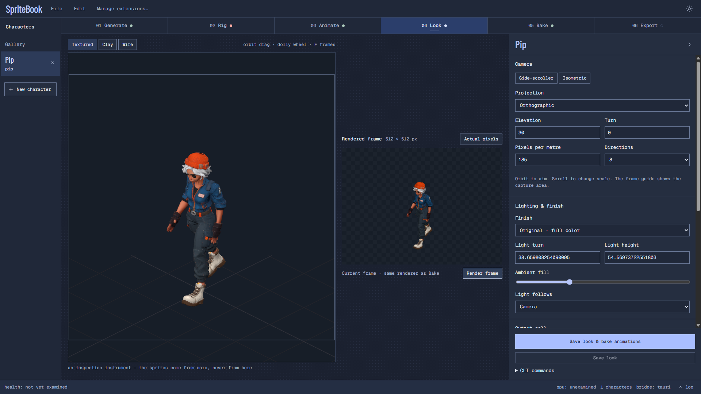

# SpriteBook

Make game sprites from a character image, on your own machine.

Generate a textured 3D model, review its rig and animations, then render spritesheets for your game.
You can also bring a rigged mesh or start with the bundled offline example.



[Get started](docs/user/README.md) · [User guide](docs/user/guide.md) ·
[Architecture](docs/developer/architecture/architecture.md) ·
[Releases](https://github.com/labcoder/spritebook/releases)

## What you can make

- **A character from one image.** TRELLIS.2 and Pixal3D generate meshes and textures locally.
- **Animated sprites.** Review walking, jumping and other bundled clips before committing to a rig.
- **The look your game needs.** Compose the camera and lighting; keep the model's appearance or use
  pixel, cel and painterly finishes. Output cells range from 64 to 4096 pixels.
- **Files you can use.** Export Godot resources, TexturePacker or Aseprite metadata, PNG strips, or
  the 3D model and its textures.

`Generate → Rig → Animate → Look → Bake → Export`

## Try it

SpriteBook is a **Windows x64 preview**. Use a release's Windows installer when one is attached;
development builds also appear in the
[candidate workflow](https://github.com/labcoder/spritebook/actions/workflows/release.yml). Unsigned
preview builds may show a Windows security prompt.

Open **New character → Use a mesh or offline example** to try capture and export without AI model
downloads. For image generation, install the required models through **File → Manage extensions**.
The current AI recipes require an NVIDIA/CUDA GPU; their downloads and memory needs vary. Check
[hardware and model requirements](docs/user/models.md) before downloading.

Automatic rigging still needs review: hands, loose clothing and skirts can deform or intersect in
motion. An authored rig is the most reliable input for trying sprite capture. See
[platform support](docs/platform-support.md) and the [changelog](CHANGELOG.md) for the preview's
limits.

## Development

Use Node **24.22.0**, npm, Rust/Cargo and the platform's Tauri build prerequisites. On Windows,
install the MSVC C++ tools and Windows SDK.

```sh
npm ci --ignore-scripts
npm run dev:desktop
```

The app uses a TypeScript/Node core, a Python model sidecar and Tauri/React. Core produces the
animation and sprite output; Studio provides the editor.

Read the [development guide](docs/developer/development.md) for builds and checks, the
[architecture](docs/developer/architecture/architecture.md) for module and storage boundaries, and
[contribution guide](CONTRIBUTING.md) before sending changes. The
[documentation map](docs/README.md) covers both user and developer guides.

## License

SpriteBook uses [AGPL-3.0-only](LICENSE), with the [output exception in NOTICE](NOTICE). Using it
does not place your exported assets under the AGPL. Model, animation and source-asset terms still
apply; read [licensing](docs/licensing.md) before shipping your work.
