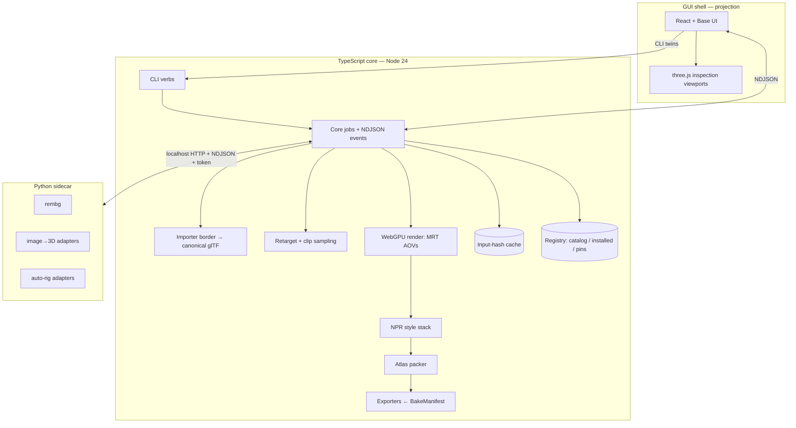

# SpriteBook — architecture

## System overview

Three application layers, with owned workers for expensive jobs:

- **Core (TypeScript on Node 24 LTS).** Owns manifests, jobs, the importer border, animation
  retargeting, rendering/style/pack/export, caching and CLI composition. JavaScript is emitted by
  TypeScript project references; normal package exports resolve the emitted modules. Headless WebGPU
  uses pinned Dawn (`webgpu` 0.6.2), with explicit device/root disposal. F4's paired Windows
  workload matches the legacy control's pixels; old PNG bytes and renderer cache identities differ.
- **AI sidecar (Python).** Adapters for background removal, image→3D and auto-rigging. Core starts
  an authenticated loopback service; isolated model workers hold incompatible CUDA dependencies. The
  application bundles its own Python source, frozen recipes and uv executable. uv provisions Python
  and environments in writable machine data; weights and third-party model runtimes are separate
  downloads behind registry gates. See [model management](../models.md).
- **GUI shell (Tauri v2 — D-005 ratified, resolved by P0-T3).** React 19 + Vite + Base UI +
  hand-authored tokens, built by Vite in the same locked npm workspace. A projection of core: it
  invokes CLI verbs, renders the NDJSON stream, and displays core-produced pixels. Three.js
  viewports are inspection instruments only — and must be able to degrade to core-rendered PNG
  sequences where a platform cannot provide the inspection renderer. The bridge uses per-job IPC
  channels for stdout and stderr, with explicit cancellation and process ownership. Tauri remains
  the selected shell (D-041); native macOS/Linux/Windows ARM64 execution remains an F7 gate.

## The laws

1. **Manifest as the only interface (D-002/D-003).** Every capability is a CLI verb over manifest
   files. GUI features that lack a verb are architecture bugs.
2. **Preview/export parity (D-006), extended: retarget-once.** One render core serves previews and
   bakes. Animation preview clips are retargeted _by core_ and streamed to the GUI; the GUI never
   runs its own retarget — two implementations would eventually disagree, and the user would tune
   against a lie.
3. **Cache = f(inputs) (D-011).** Keys hash canonical inputs — mesh hash, rig state, clip binding,
   camera preset, style preset, `rendererVersion`, backend@version+params — and bind to the
   immutable `characterId`. Output pixels are never hashed (GPUs are not cross-machine
   deterministic). Renaming a character invalidates nothing.
4. **glTF at the border (D-012).** All ingestion (glb/gltf/obj/fbx/vrm) normalizes to canonical,
   uncompressed glTF with enforced conventions: +Y up, meters, faces +Z (VRM 0.x rotated on import),
   feet at Y=0, uniform scale. Emits a persisted `PreflightReport`. Double-import of the same source
   must produce identical bytes (CI-enforced).
5. **Registry is data (D-009).** Three layers, npm-style: `catalog` (models.json: entries, versions,
   licenses, territories, VRAM/disk, `paramsSchema`) → `installed` (per-machine state under the
   platform local-data directory, or `SPRITEBOOK_MODELS_DIR`, verified hashes) → `pins` (per-project
   exact versions). Backends and **animation packs** are both catalog citizens. Gates (license
   acceptance, territory, VRAM preflight) run before install and before jobs.
6. **BakeManifest is canonical (D-010).** Frames, atlas pages, pivots, metrics, flags. Exporters are
   pure projections; AOV pages (normal/mask/depth) are rect-identical to the lit page — engines can
   swap textures under one layout.
7. **Undo is core.** Every mutation is a `ManifestPatch {op, inverse}` appended to a journal;
   `spritebook undo` and the GUI stack replay it. No GUI-only state worth keeping exists.
8. **Determinism.** Fixed, recorded seeds; deterministic quantization; same machine → same bytes
   (double-render canary in CI). Anything stochastic takes its seed from the manifest.

## Event & diagnostics contract

Jobs emit NDJSON: `queued | started | progress | artifact | warn | error | done`, each with jobId,
timestamps, and `retryable` on errors. Core keeps a session ring buffer plus an optional file sink;
the GUI's log drawer renders the stream **verbatim** — what CI sees is what users see. Errors badge
the collapsed status bar.

## Sidecar contract

HTTP on `127.0.0.1`; per-session bearer token minted by core; version handshake on connect; job
endpoints stream NDJSON back. The wire contract lives in
[`packages/schema/sidecar.ts`](../../packages/schema/sidecar.ts), mirrored by Python. Adapters
declare `paramsSchema` (JSON Schema) that both validates `GenerationResult.params` and drives GUI
option forms. Rig adapters accept optional **joint placement hints** (the re-run-with-markers escape
hatch). GPL tooling (e.g. Blender/bpy used by upstream UniRig scripts) stays inside the sidecar
process boundary; adapters return neutral data (skeleton/weights as npz/json) that core applies to
glTF itself. Models and prepared runtime source files are verified before inference. Setup uses
frozen wheels and native admission checks; a failed setup retains verified weights for `models
setup`. Qualified inference uses local files without a Hub fallback. Hugging Face supplies artifacts
and authentication; no Hugging Face desktop app is required.

## Rigging tracks

- **Track A (humanoid roster fit):** a canonical rigged body (seeded from CC0 Universal Base
  Characters) fitted to generated meshes; identity carried by textures, detail-layer decals,
  attachments, and bone masks; shared UVs enable palette ops at roster scale. Mirroring **opt-in per
  character** (D-008) — asymmetric identity is first-class.
- **Track B (generic):** UniRig (MIT, code+weights) for arbitrary topologies. Candidate accelerator
  for A: Make-It-Animatable (<1 s humanoid rig, meshes _and_ splats, arbitrary input pose) —
  **license gate open; verify before integration.**
- Repair verbs are core capabilities (p3): `rig --edits <patch>`, `--face-front`, `--feet-ground`,
  `--center`, `--rerun-with-hints`. The GUI's two-tier repair UI wraps them.

## Module map (npm workspaces under `packages/*` and `apps/studio`)

| Package            | Owns                                                                                            |
| ------------------ | ----------------------------------------------------------------------------------------------- |
| `schema`           | Authoritative types and Zod validation, `ManifestPatch`, document migrations                    |
| `core`             | Queue, events, journal/undo, cache, orchestration                                               |
| `importer`         | Border: readers (glTF-Transform, three-FBX bridge, obj2gltf), canonicalization, PreflightReport |
| `image`            | Shared PNG codec and PNG/JPEG ndarray boundary; avoids Sharp/libvips in the runtime             |
| `render`           | Headless WebGPU: MRT AOVs, skinning, readback                                                   |
| `style`            | NPR stack: quantize (OKLab), dither, outlines, temporal toolkit, flicker metric                 |
| `anim`             | Pack ingestion, humanoid retarget profile, clip sampling, preview clip emission                 |
| `pack`             | MaxRects atlasing, parallel-layout guarantee, contact sheets                                    |
| `gen`              | Generation pipeline: registry → sidecar → **the border** → GenerationResult; reprojection       |
| `rig`              | Canonical body fit, generic skeleton/weights application, repair and deform reports             |
| `export`           | Godot / Aseprite / TexturePacker / strips — projections of BakeManifest                         |
| `registry`         | Catalog/installed/pins, gates, verify                                                           |
| `cli`              | Verb surface (`gen, pick, rig, anim, look, bake, export, models, clone, rename, undo…`)         |
| `apps/studio`      | Tauri/React shell; framework-agnostic inspection viewport classes                               |
| `sidecar` (Python) | Adapters: rembg, gen backends, rig backends                                                     |

Humanoid retargeting validates mapped ancestry before sampling. Arm bind-pose differences above 15°
receive a measured rest-reference swing; wrists and digits inherit the forearm correction. Joint
translations and bone lengths still come from the target. This applies in core to both preview and
bake. The animated-pixel change advances the shared renderer cache namespace to
`spritebook-render@0.6.1`; old frame caches are not reused for the changed poses.

Look frame previews are a read-only CLI job over the bake sampling/render/style path, with stable
full-clip framing. Orthographic scale remains world-locked; perspective expresses pixels per metre
at the pivot plane. Optional style lighting is part of the cache inputs. Styling reads one AOV frame
at a time and pools a deterministic bounded sample for large adaptive palettes; packing decodes one
atlas page at a time. Full-resolution cells are preserved; contact GIFs are thumbnails.

## Non-goals of the architecture

No cloud services in the core path; no telemetry; no plugin system in 1.0 (exporters are in-tree
projections); no cross-machine render determinism assumptions, ever.

## Contracts and storage

[`packages/schema`](../../packages/schema/mod.ts) is the source of truth; the
[data-model index](data-models.ts) points to each contract. Character manifests are version 3;
Project, BakeManifest and AnimPack remain version 2. Other documents have their own version gates.
Reads migrate legacy character data in memory; the next mutation persists the current shape.

A character workspace owns `character.json`, source/results, accepted canonical asset revisions,
rig/animation data and bakes. Project model/pack pins live at the workspace's immediate parent.
Machine-level model files and Python/runtime directories are independent of these assets; removing a
generator does not remove accepted meshes, history or exported sprites. See
[workspace persistence](workspace-persistence.md), [execution policy](execution-policy.md) and
[model storage and removal](../models.md#storage-and-removal).

Generation prepares opaque references in core through the same `runPrepJob` used by the `prep` verb.
The original source remains content-addressed; optional `source.prepared` records the PNG cutout
hash, exact backend version and parameters. That pointer is journaled. Core generation, reprojection
and retexturing use the cutout, while Studio's source comparison shows the original. Retries reuse a
hash-verified cutout; missing or invalid files are prepared again. Preparation finishes and releases
its worker/VRAM lease before the generator claims memory. Missing prep weights return
`model-missing`, with no automatic download or bypass of project pins and execution policy.

`pick` copies the inspected candidate byte-for-byte by default. Source-colour matching and detail
reprojection are explicit opt-ins in core, CLI and Studio. Requested passes stage their changes
before the single journaled promotion, pin the image hash and retain the original result. Studio
shows the saved canonical asset after picking; Rig reads the same saved asset.

## F1 persistence and execution policy

The [workspace persistence protocol](workspace-persistence.md) defines the recoverable writer,
canonical asset revisions, job ownership and consistent read projections. The
[execution policy](execution-policy.md) defines project pins, receipt verification, declared consent
and configuration-specific VRAM admission. These protocols preserve the laws above on Node. The
[Windows renderer proof](../../future/renderer-qualification.md) and
[F4 cutover evidence](../../future/runtime-cutover.md) record the runtime transition and remaining
release gates.

## Installed ownership

Tauri launches app-owned Node and `runtime/core/cli.mjs` through the shared native process owner.
The portable `spritebook` launcher owns the same worker tree. Native code handles process groups/
Windows Job Objects and kernel file locks; TypeScript owns all product policy. Startup gates prevent
workers escaping before assignment. Cancellation keeps each job's stdout/stderr channels separate.

`SPRITEBOOK_RESOURCES` identifies immutable catalogs, shaders, clips, bodies and Python source.
Source development resolves equivalent assets from compiled packages. `ubc-male` is the portable
bundled body ID; explicit body paths remain supported. The installer includes the locked production
package tree so importer CJS loaders and decoders retain their relative assets. It contains no
source TypeScript, development node_modules, compiler, model weights or copied virtual environment.

Owned uv uses frozen resolution and normal wheel installation, avoiding locale-decoded editable
paths on Windows. Installed Python environments live in writable platform application data, keyed by
the sidecar lock; `UV_PROJECT_ENVIRONMENT` remains an explicit override. Runtime builds stage and
seal the complete payload before publishing, and recover a previous generated payload if interrupted
between directory renames. This builder guarantee is separate from F7's clean-machine installer
upgrade/uninstall qualification.

The Windows x64 F4 cutover, TRELLIS.2/UniRig workflow and optional Pixal3D workflow are complete
within the recorded RTX 3090 scope. [Platform support](../platform-support.md) separates those runs
from native targets and experimental model ports. F7 retains clean-machine, installed-app recovery,
engine import, notices, signing and accessibility gates; current qualification candidates are not
signed public releases.
