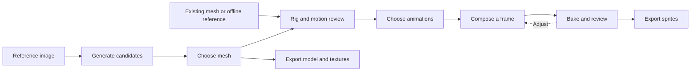

# Product direction

SpriteBook helps solo and small teams turn character images or existing meshes into reusable game
sprites. The current application uses a TypeScript/Node core, a Python model sidecar and Tauri/React
Studio. The [user guide](../user/guide.md) describes implemented interactions;
[platform support](../platform-support.md) separates tested paths from future targets.

## The problem

A roster multiplies drawing work: characters × animations × directions × frames. A game with 300
characters, 10 animations, 8 directions and 8 frames per clip needs 192,000 frames. Changing an
outfit, camera angle or art style can mean doing much of that work again.

A reusable 3D character makes those variations cheaper to render. Open-weight generation and rigging
models make that workflow accessible to more developers, but the output still needs review.
SpriteBook brings generation, motion checks, capture and delivery into one local editor.

## Who it serves

- Solo and small-team developers making RPGs, sims, tactics games and other 2D character games.
- Artists using rendered characters for blockouts or reference.
- Developers who already have meshes or authored rigs and want repeatable sprite capture.

Asymmetric character details matter. Tattoos, clothing, prosthetics and attachments must retain
their intended side; mirroring stays an explicit per-character choice.

## Product commitments

- **Local operation.** Character inference, animation and capture run on the user's machine.
  Model/runtime setup may download declared third-party files after the required consent.
- **A useful path before large downloads.** The bundled authored reference and existing-mesh import
  let users try capture/export before installing AI models.
- **Review before commitment.** Retain generated candidates and source assets. Show motion on the
  character before rig acceptance or candidate selection; numerical findings supplement visual
  review rather than certify anatomy.
- **Repeatable rendering.** Preview and bake share core sampling/rendering. Recipes record model,
  camera, style and animation settings; cache identity follows canonical inputs.
- **Recoverable editing.** Ordinary durable edits support undo/redo. A failed job preserves the last
  accepted asset. Permanent project deletion is explicit, confirmed and preserves originals.
- **Honest setup.** Show licenses, territory restrictions, disk use and hardware admission before
  downloads or inference. Installed weights and runtime readiness are different states.
- **Usable delivery.** Export saved bakes to documented game formats, with stable pivots and
  parallel atlas layouts. Also support canonical GLB/texture delivery.

## The workflow

| Stage         | User outcome                                                                                 |
| ------------- | -------------------------------------------------------------------------------------------- |
| New character | Name a character; choose an image, existing mesh or offline reference                        |
| Generate      | Prepare the source, generate candidates, inspect and select a canonical mesh                 |
| Rig           | Preserve an authored rig, predict a rig or fit a template; inspect alignment and deformation |
| Animate       | Choose clips, frame counts, speed and loop/hold behavior; review retargeted movement         |
| Look          | Compose a camera and lighting, choose a finish and size, inspect one core-rendered frame     |
| Bake          | Render the animation set, pack atlas pages and review clipping/motion flags                  |
| Export        | Deliver sprites, engine metadata and optionally the saved model/textures                     |

The top stage rail provides navigation. A character index supports switching workspaces; the main
canvas stays left and a resizable inspector stays right. Advanced settings and raw diagnostic paths
appear on demand. Core capabilities also have CLI operations so automation and Studio use one
behavior implementation.

## Boundaries

SpriteBook is not a sculpting, pixel-painting or full animation-authoring suite. Existing tools
remain appropriate for manual topology, skinning and clothing repair. Generated loose garments,
contacting limbs and uncertain joint maps remain difficult inputs; model setup and rig acceptance
must not imply a collision-free result.

Windows x64 is the current desktop preview target. Mac/Linux/ARM support, clean-machine packaging,
signing and wider native accessibility/hardware qualification have separate gates. A successful CI
build does not close them.

## Targets to measure

These are planning budgets, not promises for every mesh, model or computer. Record exact source,
hardware, recipe and input size with each measurement.

| Metric                                     | Target                                                          |
| ------------------------------------------ | --------------------------------------------------------------- |
| Rigged mesh to sprite output, cold CLI run | Within 10 minutes for the reference workload                    |
| Image to a reviewed character export       | Within 30 minutes for a qualified recipe                        |
| Restyle a 100-character roster             | Unattended overnight run with per-character recovery            |
| Temporal stability                         | Preset-specific idle-loop changed-pixel budget at or below 1.2% |
| Setup transparency                         | No surprise model downloads; declared gates before install/run  |

The [roadmap](../../future/roadmap.md) retains milestone scope. Future editor work includes clearer
quality repair, frame-level proofing, selective rebakes and a sprite-playback sandbox. Batch work
must preserve per-character errors and cache reasons rather than hiding failures in a roster run.
