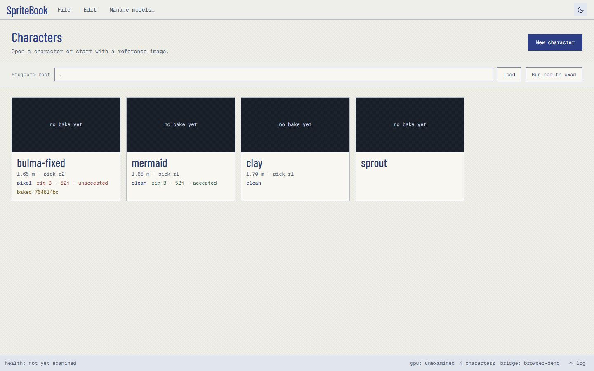
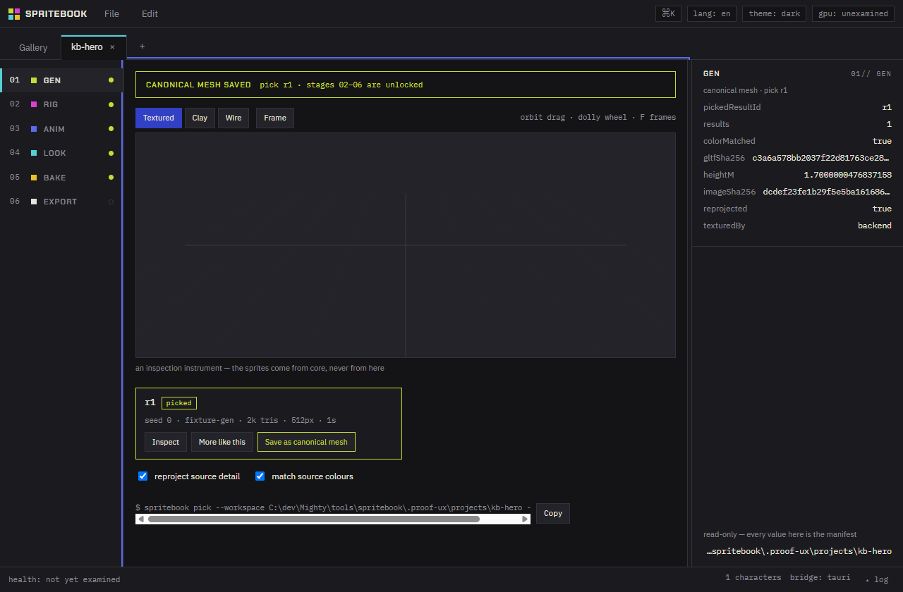
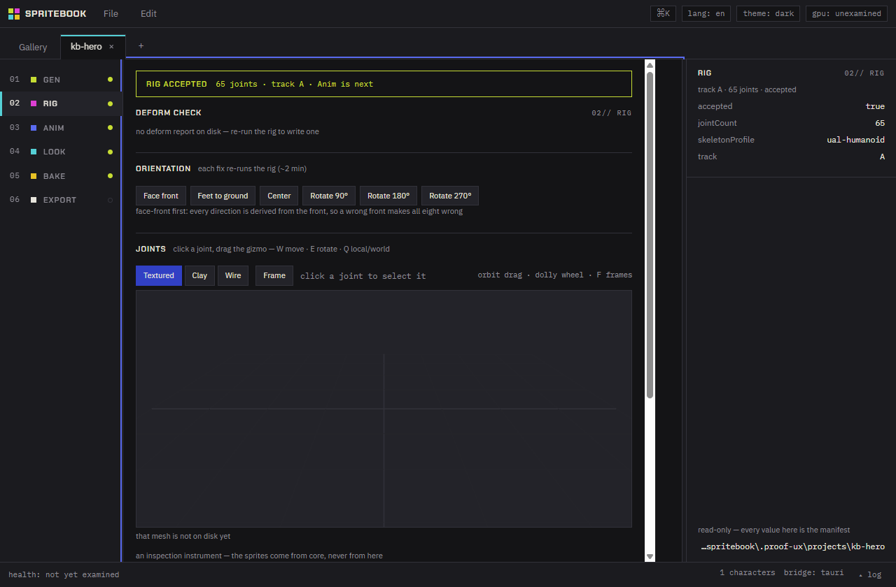
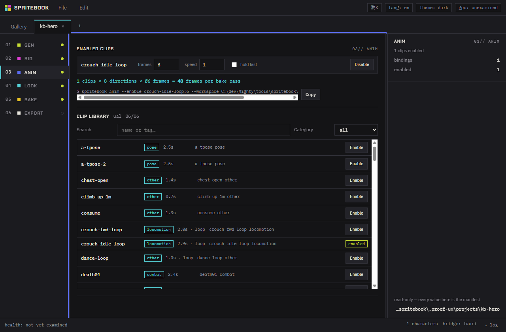
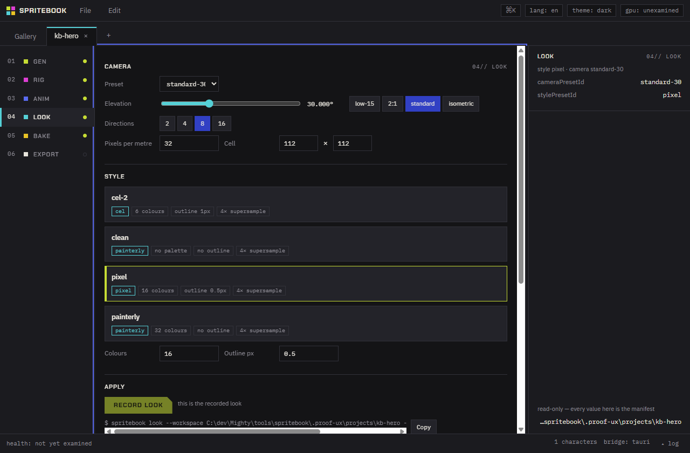
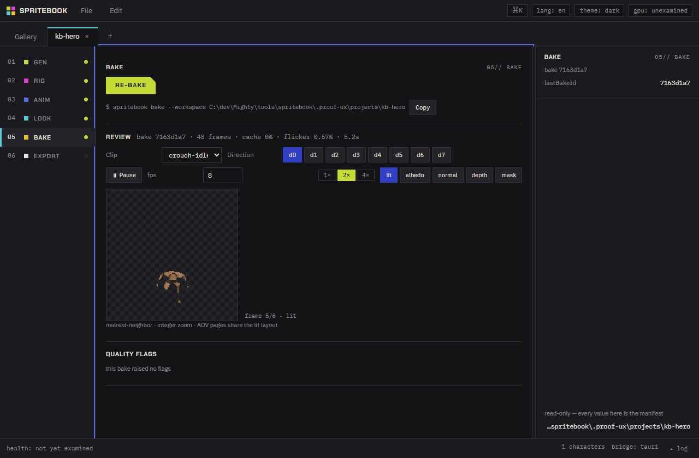
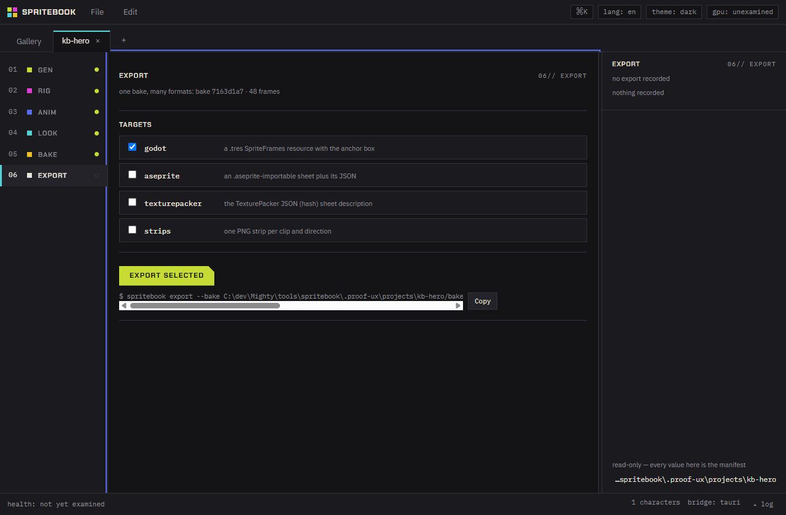

# SpriteBook Studio user guide

NOTE: Studio ships with the 1.0 bundle. The alpha zips carry the CLI only,
and every action below has a CLI twin — see [the CLI reference](cli.md).

SpriteBook turns a character image into engine-ready 2D spritesheets. It runs on your machine.
Nothing goes to a server.

Studio is the guided editor. It has six stages, from the source image to the exported files. Each
stage wraps a command of the SpriteBook CLI. The CLI does everything Studio does, and each primary
button shows the exact command it runs. To work in the terminal instead, read
[the quickstart](quickstart.md).

This guide is about the app. Read the quickstart first if you want the shortest path to a
spritesheet.

## 1. Open a project

A **workspace** is one folder for one character. It holds the manifest, the mesh, the bakes, and the
exports. A **projects root** is a folder that holds many workspaces.

1. Start SpriteBook Studio.

2. Type the path of your projects root in the **Projects root** box.

3. Select **Load**, or press Enter.

The gallery shows one card for each character in the root. Select a card to open that character in a
tab. Select **+** to make a new character.

The tab strip holds the gallery and each open character. The status bar at the bottom shows the
character count, the bridge (which engine runs your commands: `tauri` is the real CLI, a browser
preview is a demo), and the log handle (opens the session log — every line the CLI writes).

To check your machine, select **Run health exam**. It reports the GPU, the sidecar (the local
Python helper process that runs the AI models), and the installed models.

## 2. Stage 01 — Generate

Generate makes a 3D mesh from one image. It then saves one result as the **canonical mesh**.

Stages 02 to 06 stay locked until a canonical mesh exists. The rail states this instead of hiding
it.

To make a character:

1. Select **+** in the tab strip.

2. Type a name. Studio makes the character id below the box. The id is lowercase letters, digits,
   and dashes.

3. Type the path of your source image, or drop the image on the window.

4. Select a backend. The cards come from the model catalog and show each backend's license, VRAM
   need, and install state.

   CAUTION: the license badge on a card names the MODEL license, not the license of the whole stack
   the backend runs on. The TRELLIS.2 backend needs components that block commercial use today. Read
   [Licensing](licensing.md) before you sell work made with a downloaded backend. The `fixture-gen`
   backend and every other stage are clear.

   Set your expectation for `fixture-gen`. It turns the image's outline into a lathe-like stand-in
   body. It proves the pipeline without a GPU; it does not produce a likeness. A likeness needs
   TRELLIS.2 and an NVIDIA card.

5. Check the **Height (m)** field. The default is 1.7. CAUTION: this is the size every later
   stage believes. Sprites frame at pixels-per-metre, so a character that keeps the backend's own
   scale bakes about 30 px tall. Clear the field only when you want the backend scale; the job
   then warns and states the measured height.

6. Change the options if you need to. The form comes from the backend's own schema. Only the values
   you change travel to the command.

7. Select **Generate model**.

The button stays disabled until the form is complete. The text beside it names what is missing.

The run writes one or more candidates. Each card shows the seed, the triangle count, the texture
size, and the wall time. Select **Inspect** to see a candidate in the 3D viewport.

To keep a candidate, select **Save as canonical mesh**. This is the checkpoint. The other stages
unlock.

Select **More like this** to run the same recipe again with a new seed.

Two options apply at the moment you save: **reproject source detail** and **match source colours**.
Both are on by default.

**The CLI twin:** `spritebook gen` and `spritebook pick`.

## 3. Stage 02 — Rig

Rig gives the mesh a skeleton, so the animation clips can move it.

There are two tracks:

- **Track A — canonical body fit.** SpriteBook fits a bundled body to your mesh. Use this for a
  humanoid character. It is fast and it needs no model download.
- **Track B — predicted skeleton.** The UniRig model predicts a skeleton. Use this when the
  character is not a standard humanoid.

To rig a character:

1. Select the track. Use the arrow keys to move between the two cards.

2. For Track A, check the body path. Two bodies are bundled, `ubc-male` and `ubc-female`; `ubc-male` is the default.

3. Select **Run rig**.

The **Deform check** section reports the result. It shows the worst tear first and states how many
joints are clean.

Six orientation buttons fix a mesh that faces the wrong way: **Face front**, **Feet to ground**,
**Center**, and **Rotate 90**, **Rotate 180**, **Rotate 270**. Each one runs the rig again.

**Accept rig** records that you looked at the report and the result is good. Acceptance is your act,
not a default. A bake with an unaccepted rig raises a warning but still runs.

CAUTION: acceptance costs nothing to record, but a rig you never checked can produce bad skinning in
every frame of every clip. Read the deform report before you accept.

To repair a rig, use **Auto-hint from this report and re-run**, or supply a joint-edits file.

**The CLI twin:** `spritebook rig`.

## 4. Stage 03 — Animate

Animate selects the clips to bake. The bundled library has 86 clips, with 8-direction locomotion.

To add a clip:

1. Type in the **Search** box, or select a **Category**.

2. Select **Enable** on the clip you want.

The clip appears as a binding row. Each row has three values:

- **frames** — how many frames to bake for this clip.
- **speed** — the playback rate.
- **hold last frame** — on for a clip that must stop, such as a death.

Change a value, then select **Record change**. Nothing is recorded until you do.

Select **Disable** to remove a clip. The numbers stay, so a later **Re-enable** brings them back.

The frame count controls the bake cost. Frames per clip, times directions, times clips, gives the
total frames. The stage shows this arithmetic.

**The CLI twin:** `spritebook anim --enable` and `spritebook anim --disable`.

## 5. Stage 04 — Look

Look sets the camera and the art style. It is the stage that decides what the sprites look like.

The camera controls are:

| Control               | What it does                                                       |
| --------------------- | ------------------------------------------------------------------ |
| **Preset**            | selects a camera preset, such as `standard-30`                     |
| **Elevation**         | the camera angle above the ground, in degrees                      |
| **Directions**        | how many directions to bake: 2, 4, 8, or 16                        |
| **Pixels per metre**  | the world-locked ruler. The whole roster shares it                 |
| **Cell width/height** | the size of one sprite cell, in pixels. The shipped default is 112 |

The elevation has detent buttons at the common angles. The slider moves 0.5 degrees for each arrow
key press.

The style cards set the look: the colour count, the outline width, and the dither. Use the arrow
keys to move between the cards.

The direction strips below show real pixels from the last bake, at integer zoom.

CAUTION: every frame key holds the whole recipe, so a look change makes every baked frame stale. The
stage states the exact frame count before you record. This is all-or-none: there is no partial
re-bake after a look change.

Select **Record look** to save the change. Select **Reset to recorded** to drop it.

**The CLI twin:** `spritebook look`.

## 6. Stage 05 — Bake

Bake renders every frame and packs them into spritesheet pages.

1. Select **Bake sheet**.

The progress line reports the four steps of the bake. The estimate stays silent until it is honest.

When the bake completes, the **Review** section appears. It reports the frame count, the cache hit
rate, the flicker percentage, and the wall time.

The player shows the result:

- **Clip** selects the animation.
- **d0** to **d7** select the direction.
- **Pause** stops the player. **fps** sets the rate.
- **1x**, **2x**, **4x** set the zoom. The zoom is always an integer, with nearest-neighbour
  sampling, so what you see is the real pixels.
- **lit**, **albedo**, **normal**, **depth**, **mask** select the render pass. Every pass page has
  the same layout as the lit page.

**Quality flags** report problems the bake found. Each flag names the stage that owns the fix, and
its button takes you there.

| Flag                      | What it means                                                               |
| ------------------------- | --------------------------------------------------------------------------- |
| `silhouette-clipped`      | the character reaches the cell edge. The flag states the edge and the width |
| `outline-exceeds-padding` | the outline is wider than the padding, so it is cut                         |
| `anim-foot-contact`       | a planted foot leaves the ground in a clip                                  |
| `anim-unmapped-core`      | a core joint of the clip has no match in the rig                            |
| `mirroring-on`            | the bake mirrored directions instead of rendering them                      |

A `silhouette-clipped` flag on the bottom edge is often the ground band, not lost pixels. At an
elevation the ground plane projects as a band, so a foot nearer the camera lands below the pivot row
with every vertex still at or above the ground. The flag states the contact width so you can tell a
2-pixel graze from a real cut.

**The CLI twin:** `spritebook bake`.

## 7. Stage 06 — Export

Export writes the files your engine reads. One bake can feed every target.

1. Select the targets you want.

2. Select **Export selected**.

3. Select **Open folder** to see the files.

| Target          | What it writes                                       | Guide                                   |
| --------------- | ---------------------------------------------------- | --------------------------------------- |
| `godot`         | a Godot 4 SpriteFrames resource                      | [Godot](engines/godot.md)               |
| `texturepacker` | TexturePacker JSON Hash. Unity and Phaser read it    | [Unity](engines/unity-texturepacker.md) |
| `aseprite`      | Aseprite JSON array, with frame tags                 | [Aseprite](engines/aseprite.md)         |
| `strips`        | one horizontal strip PNG for each clip and direction | [Phaser](engines/phaser.md)             |

The exporters are pure projections of one bake manifest. The same bake always writes the same bytes.

**The CLI twin:** `spritebook export`.

## 8. Keyboard use

Every control is reachable with the keyboard alone. The full journey was driven this way, and a test
holds it there.

| Key                  | What it does                                                                                             |
| -------------------- | -------------------------------------------------------------------------------------------------------- |
| Tab, Shift+Tab       | move between controls                                                                                    |
| Enter, Space         | activate the focused control                                                                             |
| Arrow keys           | move inside a group: the tabs, the stage rail cards, the backend cards, the track cards, the style cards |
| Ctrl+K               | open the command palette                                                                                 |
| Ctrl+M               | open **Manage models**                                                                                   |
| Ctrl+Z, Ctrl+Shift+Z | undo and redo the last recorded change                                                                   |
| Delete               | close the focused character tab                                                                          |
| Escape               | close the palette, a dialog, or the log drawer                                                           |

A group of cards is one stop on the Tab path. Use the arrow keys inside it.

When a run completes, focus moves to the new content, not back to the top of the window.

## 9. When a run fails

Every command SpriteBook runs writes its output to the **session log**. Select **log** in the status
bar to open the drawer. The drawer shows each line exactly as the command wrote it. Nothing is
summarized and nothing is hidden.

1. Open the log drawer.

2. Select the **error** filter.

3. Read the last lines of the failed job.

Select **Copy** to copy the visible lines. Select **Replay previous session** to load the log of the
run before this one.

The drawer opens by itself when a journal command fails.

## 10. Undo

Each recorded change is a journal entry. Ctrl+Z reverts the last one for the active character.
Ctrl+Shift+Z applies it again. The Edit menu holds the same two commands.

Undo covers the recorded decisions: the pick, the rig acceptance, the clip bindings, and the look.
It does not delete the files a bake wrote.
