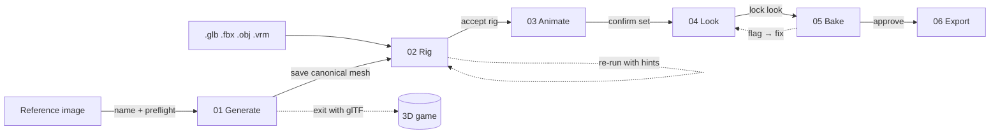

# SpriteBook — product requirements

## Problem

2D character art scales multiplicatively: **characters × animations × directions × frames**. A cozy
sim with 300 unique townsfolk, 10 animations each, 8 directions, ~8 frames per clip needs **192,000
frames**. Hand-drawing is out of reach for solo and small teams; commissioning is out of budget;
style drift across artists breaks cohesion; and every design change (new palette, new outline width,
one more animation) multiplies again.

## Insight

Model once in 3D, render infinitely to 2D — the pipeline behind Diablo's prerendered sprites,
Factorio's one-click re-renders, and Dead Cells' 3D-to-pixel workflow. It was always the right
answer and never accessible: it required 3D artists, riggers, and a homebrew render farm.
Open-weight image-to-3D generation and learned auto-rigging remove the humans-in-the-middle.
**SpriteBook automates the whole path: the 3D is an implementation detail; the sprites are the
product.**

## Users

- **Primary:** solo/small-team 2D game developers with character rosters (sims, RPGs, roguelikes,
  tactics). Anchor user: the maintainer's own cozy sim — hundreds of unique humanoid townsfolk with
  fine, _asymmetric_ identity details (tattoos, prosthetics, alopecia). Asymmetry is a first-class
  constraint, not an edge case: mirroring is opt-in per character.
- **Secondary:** pixel/2D artists using it for blockouts and reference; 3D-capable devs who bring
  their own meshes (the import-mesh path skips straight to rigging).

## Goals / non-goals

**Goals:** free and local-first; one reference image → engine-ready sheets; large-roster scale
(batch, cache, incremental rebake); temporal stability that beats the historical flicker problem;
honest guidance (licenses, VRAM, territories surfaced before download); headless CLI as the
canonical interface with a guided GUI on top.

**Non-goals (1.0):** an art editor (Aseprite exists); non-character assets (props/tilesets later);
cloud rendering; multiplayer/collab; non-humanoid rigging beyond UniRig's generic track.

## The journey (six stages; characters are tabs, stages are the left rail)

**00 · New character.** Name asked explicitly (never inferred from filename; labels the tab, files,
exports, CLI target — renameable because identity is an immutable `characterId` slug). Drop an image
(PNG/JPG, front-facing A-pose advised) or a mesh (.glb/.fbx/.obj/.vrm → straight to Rig).

**01 · Generate.** Preflight streams in (background removal is async with a visible processing
state; pose check is an advisory heuristic). Backend cards come from the registry catalog: license,
territory, VRAM-vs-detected, install state — the model manager gate appears _in context_ when
weights are missing, and the full **Manage models… (⌘M)** dialog lives under File. Per-backend
options render from the adapter's `paramsSchema` (Pixal3D: quality/texture size; TripoSplat:
gaussian count). **Default = generate one model.** Seed is a recorded receipt, not a decision;
iteration is "More like this" and "Adjust settings", post-hoc. Results arrive **textured**
(Pixal3D/TRELLIS.2 emit geometry+textures together; geometry-only backends insert a texture
substage) with Textured/Clay/Wire inspection and full orbit/pan/zoom/frame controls. Optional detail
reprojection keeps tattoos crisp. Checkpoint: **Save canonical mesh** — unlocks the rail; also a
valid exit for 3D-game users.

**02 · Rig.** Auto-rig, then a two-tier repair model. Tier 1: click any joint in the bone overlay,
gizmo-nudge it (mirror L↔R optional, snap-to-estimate, reset), with test-pose deformation checks.
Tier 2 (structural): orientation is a set of checks with one-click fixes — **facing +Z** (all
direction math derives from "front"), feet at Y=0, centered at origin. Escape hatches: re-run
auto-rig using nudges as placement hints; switch to the roster-fit Track A body.

**03 · Animate.** A CC0 clip library (bundled Quaternius UAL free tiers; Mesh2Motion assets as
alternate; user imports incl. personal Mixamo — used, never redistributed). Selecting a clip
**retargets live on the user's character** (which doubles as rig QA). Per-clip: enable, frames,
speed, hold-last. The combinatorial math stays visible before commitment: _3 clips × 8 dir × Ø7
frames = 168 frames/pass_. Directions and cell size are owned by the camera preset (04) and
summarized here.

**04 · Look.** Camera (elevation slider with detents 15°/26.6°/30°/35.3°, direction count, px/m
world-locked, cell size) and style (presets, outline width, palette) tuned against **pixel truth**:
core-rendered direction strips at nearest-neighbor integer zoom. Changes state their cost: "marks N
frames stale" — rebaked incrementally.

**05 · Bake & review.** "Generate sprites" runs the queue; per-clip segmented progress, cache-hit %,
honest ETA. The **status bar expands upward into the log drawer**: the raw NDJSON event stream,
severity-filtered, with errors badging the collapsed handle (nothing fails silently; retryable
failures show their retries). Review = an interactive **sprite player** (8-direction selector,
transport, fps, AOV pass toggles — no GIFs) plus the delight moment: a **keyboard sandbox** driving
the actual baked sprites (arrows move/face, number keys trigger clips) — QA disguised as joy.
Frame-level flags (e.g. outline exceeds padding) link back to the owning stage and support "rebake
flagged only".

**06 · Export.** Checkboxes over one BakeManifest: Godot SpriteFrames, Aseprite JSON, TexturePacker
JSON (Phaser/Unity), PNG strips, contact sheets. Atlas summary states the parallel-layout guarantee
(lit/normal/mask pages rect-identical). Done-state names every file and opens the folder.

## Success metrics

| Metric                                         | Target                                                               | Proven at              |
| ---------------------------------------------- | -------------------------------------------------------------------- | ---------------------- |
| Mesh → spritesheet (CLI, cached cold)          | ≤ 10 min                                                             | p2 alpha               |
| Image → engine-imported character              | ≤ 30 min                                                             | p3 beta                |
| 100-character roster style pivot (rebake all)  | overnight, unattended                                                | p4 hardening           |
| Temporal stability (flicker metric, idle loop) | ≤ 1.2% changed px/frame per preset budget                            | p2, regression-tracked |
| First-run honesty                              | zero surprise downloads; license/territory/VRAM gates before install | p3                     |

## Guided model manager (product stance)

Backends are catalog entries with license text, territory restrictions (Hunyuan3D excludes EU/UK/KR
— shown, not hidden), disk and VRAM requirements, verification state, and pinned versions per
project. Install/verify/uninstall are CLI verbs the ⌘M dialog wraps. SpriteBook never bundles model
weights.
