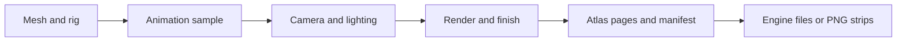

# Capture and export

Look renders a single sample for composition. Bake renders the enabled animation set, packs its
frames into atlas pages and records a `BakeManifest`. Export turns that saved bake into the formats
your game consumes. Camera, pose sampling and finish use the same core pipeline for preview and
final output.



## Compose a frame

Use Studio's Look workbench or record a CLI recipe:

```sh
spritebook look --workspace ./characters/hero --camera standard-30 --style clean --cell 256 --ppm 96
spritebook look --workspace ./characters/hero --preview --clip walk-loop --frame 0 --direction 0
```

| Setting                    | Meaning                                                                              |
| -------------------------- | ------------------------------------------------------------------------------------ |
| Projection                 | Orthographic world scale, or perspective with a field of view                        |
| Elevation and yaw          | Height of view and turn around the model                                             |
| Pixels per metre (`--ppm`) | World scale shared across a roster; higher values make the model larger in each cell |
| Cell (`--cell`)            | Output width/height: `256` or a rectangle such as `192x256`                          |
| Padding (`--padding`)      | Transparent space inside the cell, including the ground band below the pivot         |
| Directions                 | 2, 4, 8 or 16 views                                                                  |
| Supersample                | Internal antialiasing scale; output dimensions stay the same                         |

For 4K output, start with `--cell 4096 --supersample 1`. Choose a corresponding pixels-per-metre
value so the character fills the cell. Output size alone does not change world scale. A 4096px cell
with 4× supersampling requests a much larger internal render and can exceed GPU limits; SpriteBook
refuses unsupported texture/readback sizes before allocation.

Full-clip bounds keep framing stable as the character moves. With perspective, pixels per metre
applies at the pivot plane. Test the widest and lowest poses, including jump and landing, rather
than composing only the idle pose.

## Lighting and finishes

| CLI style   | Result                                                                             |
| ----------- | ---------------------------------------------------------------------------------- |
| `clean`     | Existing model materials with lighting; no palette quantization, dither or outline |
| `pixel`     | Reduced palette, ordered dither and an outline                                     |
| `cel-2`     | Flat cel tones with an outline                                                     |
| `painterly` | A larger tonal range and soft edges                                                |

`clean` appears as **Original · full color** in Studio. Use `--ambient`, `--light-yaw`,
`--light-elevation` and `--light-frame camera|world` for lighting. Palette size, outline and
supersampling are recipe inputs. Adaptive-palette frame previews remain provisional until the full
animation set is baked.

Historical `pixel-8`, `pixel-8-thin`, `pixel-8-span` and `pixel-8-both` IDs resolve to `pixel` with
a warning. Review the result; the replacement does not reproduce the retired finish byte-for-byte.

## Bake

```sh
spritebook bake --workspace ./characters/hero
```

The workspace supplies the canonical mesh, character ID, look and enabled clip bindings. Explicit
flags override those settings and the successful bake records its resolved recipe. Use `--clips
'walk-loop:8,jump-start:6!hold'` to choose bindings on the command line; `@1.5` multiplies playback
speed, and `!hold` makes the clip stop on its final frame.

For a standalone mesh:

```sh
spritebook bake --model ./hero.glb --character hero --out ./bakes --style clean --directions 8 --frames 6
```

Standalone `--frames` samples the built-in idle pose. It is not an imported animation clip.

| Bake output                                                         | Purpose                                                                  |
| ------------------------------------------------------------------- | ------------------------------------------------------------------------ |
| `manifest.json`                                                     | Frame rectangles, pivots, clip timing, inputs, metrics and quality flags |
| `atlas_lit_<page>.png`                                              | Finished spritesheet pages                                               |
| `atlas_albedo_*`, `atlas_normal_*`, `atlas_depth_*`, `atlas_mask_*` | Additional passes with the same frame layout                             |
| `style-result.json`                                                 | Style metadata and warnings                                              |
| `contact-<clip>.gif`                                                | Review thumbnail, not the full-resolution game asset                     |

Large bakes use multiple pages. New bakes keep each clip/direction sequence on one page so all
export formats can describe it. If a complete sequence cannot fit, reduce its frame count or cell
size. Review PNGs and spritesheet pages when judging resolution; contact GIFs use capped thumbnail
cells.

### Mirroring

Mirroring is off by default. `--mirror` renders fewer directions and flips the others; `--no-mirror`
turns it off. A tattoo, prosthetic or asymmetric outfit changes side when mirrored. Inspect those
details before enabling it. The bake warns and marks derived frames in its manifest.

### Cache and roster runs

`--cache <dir> --only-invalidated` reuses frames only when their canonical inputs match. A change to
mesh, rig, clips, camera, finish or render signature invalidates the affected recipe. Adapter and
exposed driver identity participate in that signature; after a driver update with no exposed
identity change, use a fresh cache.

```sh
spritebook bake --all --root ./characters --plan
spritebook bake --all --root ./characters
```

The plan reports fresh, stale and blocked characters before rendering. Runs process characters one
at a time, retain per-character failures and return a failing exit code if any character fails.
`--changed-since <ISO timestamp>` filters by manifest modification time; it does not prove that the
rendered pixels would change. Renaming a character changes metadata without invalidating its frames.

## Export

```sh
spritebook export --workspace ./characters/hero --out ./delivery/hero --targets godot,aseprite,texturepacker,strips --mesh
```

Use `--bake <dir>` instead of `--workspace` to export a specific historical bake. Export reads the
recorded `lastBakeId` for a workspace; it does not guess the newest directory.

| Target          | Files and timing                                                                      |
| --------------- | ------------------------------------------------------------------------------------- |
| `godot`         | SpriteFrames `.tres`, PNG pages, clip speed and loop state                            |
| `aseprite`      | Per-page `.ase.json`, frame durations and tags; Aseprite imports the PNG grid         |
| `texturepacker` | Per-page `.tp.json` with frame rectangles and pivots; the engine sets playback timing |
| `strips`        | One horizontal PNG per clip/direction, plus dimensions, pivots, fps and loop state    |
| `--mesh`        | Byte-preserved canonical GLB, embedded textures and `textures.json`; no bake required |

Model export includes the saved rig when present. It does not add animation clips to the GLB.
`--fps` supplies a fallback for formats that carry timing when the bake has no recorded clip timing.
Copy metadata and its referenced PNGs together. See the individual [engine guides](README.md) for
import and pivot setup.
