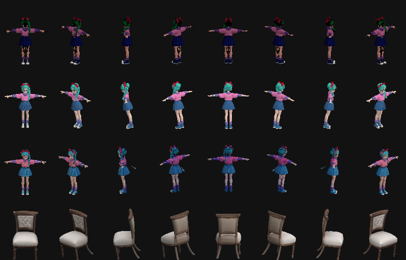
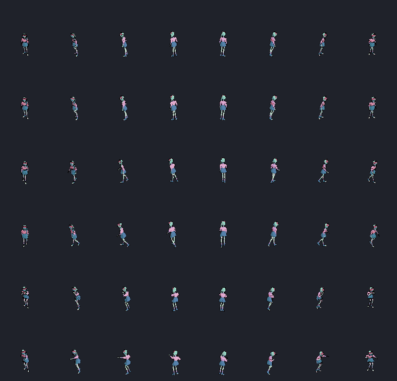

# F4 image-to-3D hardware and platform spike

Research date: **2026-10-19**. F4-T6/T7 combine primary-source research with actual Windows
experiments on the maintainer's **RTX 3090 (24 GiB, SM86, driver 610.88), i9-10900K and 63.92 GiB
RAM**. The initial free disk budget was about 48 GiB. Mac/Linux figures below are source reports,
not SpriteBook runs. App rendering, generation and auto-rigging have separate platform gates.

## Local experiments

The complete Pixal3D single-view catalog install verifies **22 files / 25,260,117,853 bytes**,
including the separately gated official DINOv3 snapshot/agreement and NAF checkpoint. The normal
model-install command provisions the isolated Windows runtime with no compiler. Native admission
executes SM86 NATTEN, actual NAF with 1,024-channel features, sparse PBR sampling, DRTK UV coverage
and finite mesh conversion. The final installed run takes **88.16 s to load**, then **51.89 s and
41.25 s to generate two candidates**; the full CLI job takes **295.12 s**, including file
verification, loading, PBR export, canonical import and thumbnails. It measures **17.53 GiB Torch
reserved / 14.22 GiB allocated**. Sampled worker peaks are **24.15 GiB working set / 46.87 GiB
private commit**; commit is not resident RAM or actual pagefile I/O. Keep the 24 GiB GPU / 64 GiB
RAM qualification host and budget about 45–50 GB free disk for a fresh stack. These are conservative
planning allowances, not proven smaller-machine minima.

Installed generation, candidate selection, UniRig, core preview, 144-frame styled/AOV bake and all
four exporters pass. The warm bake has 100% cache hits and preserves all five AOV pages after
recording rig review. Worker interruption/retry, source corruption/refusal/repair and native Tauri
model-manager/core-read checks pass with accepted assets unchanged and zero inference network
attempts. The [qualification receipt](qualification/pixal3d-windows-x64.json) seals the installer,
runtime/source/model hashes, measurements and checks. Image review caught and corrected a camera
scale mistake before accepting any output. It also identified the standalone viewer's opposite front
convention: the adapter preserves SpriteBook's Y-up/+Z-front frame. The isolated worker records
Python 3.11.16, Torch 2.8/cu128, Transformers 4.57.3 and NATTEN 0.21.6, preventing the base
sidecar's newer Transformers from silently replacing model dependencies.

A same-seed replay exposed non-repeatable CuMesh edge collapse even when all sampling tensors
matched. Adapter 0.2.0 canonicalizes mesh enumeration and uses pinned MIT fast-simplification plus
CPU normal sums, preserving native remesh/UV/PBR stages. The real-tensor control exports identical
GLBs twice (28.87/23.85 s), and the installed fresh-worker output matches that control exactly. The
final interrupted-job retry reproduces both installed candidates' raw and canonical GLBs
byte-for-byte in fresh workers. No regeneration cache or relaxed comparison hides that check.

This one 52-joint test rig reports eight advisories: stretch on `spine_03`, both clavicles, `pelvis`
and `spine_01`; no influence on both `middle_01` joints and `thumb_04_leaf_r`. Retargeting holds
`root` and `thigh_r` at rest. The sprites are usable for the bounded integration proof, with
**0.545% measured idle flicker**, but this is not approval of a new production default or general
character quality. Carry the advisories into F3-T1's broader cohort.

### Run the integrated Pixal3D recipe

First obtain personal access to the official DINOv3 repository and authenticate as described in
[model management](model-management.md). Then, on the qualified Windows CUDA tier:

```sh
spritebook models install pixal3d --accept-license
spritebook gen --workspace ./characters/hero --character hero --image cutout.png \
  --model pixal3d --height 1.7 --seed 1234 --candidates 2 --adjust fov=0.2
spritebook pick --workspace ./characters/hero --result r1
```

Use `models setup pixal3d --accept-license` to repair/recheck the runtime while retaining verified
weights. The same catalog entry appears in Studio's model manager and generation controls. This
recipe is single-view 1024 cascade, stage offload, SDPA, 12 steps and 2,048 px PBR texture; it uses
actual NAF, with no MoGe or BRIA download.
[All knobs](../docs/user/cli.md#the-knobs---adjust-takes).

### TripoSR evaluation variant

TripoSR's official checkpoint ran offline on two inputs with strict weights loading and a local DINO
configuration. Its reference CUDA marching-cubes dependency lacks a suitable published wheel, so
this experiment uses **scikit-image CPU isosurface extraction**, preserving the learned
encoder/decoder. The official texture baker also needed an explicit CUDA/CPU handoff for position
queries and output colors. This is a documented evaluation variant, not an unchanged upstream runner
or an installed SpriteBook model.

| TripoSR experiment                         |       Character |           Chair |
| ------------------------------------------ | --------------: | --------------: |
| Loaded-model geometry, 256 extraction grid |          3.34 s |          2.83 s |
| 1,024 px UV texture bake                   |          6.25 s |         38.30 s |
| Triangles                                  |          47,278 |          83,728 |
| Peak Torch reserved / allocated memory     | 2.95 / 2.32 GiB | 2.95 / 2.32 GiB |

Model construction/load took **4.08 s**, excluding Python/import startup. Torch counters omit the
OpenGL baker's allocations, context and other applications; these results do not establish a 3 GB
card requirement. Both GLBs contain finite geometry/UVs and nonconstant color, and survive a mesh
round trip. TripoSR predicts appearance, not learned PBR roughness/metallicity; the comparison
export uses explicit matte material factors. Rigging, anatomy and sprite readability still need
their own review. Raw results and pinned runtime/source files are retained under
`.render-bench/f4/alternatives/triposr/`.

### Reviewed output comparison



Rows: **TRELLIS.2 generation plus the prior accepted retexture**, **Pixal3D generation**, **TripoSR
character**, **TripoSR chair**. Columns are directions 0–7. All use the same core renderer, raw
lighting/style, 1.7 m declared height and 100×128 px cells at 56 px/m. This compares the actual
materials as well as geometry; the first row includes an additional texture stage. One character and
one prop are not a quality ranking or default-selection cohort.



The animation sheet is the installed Pixal3D → UniRig → core-retargeted styled export. Row pairs
show idle, walk and punch at frames 0/3; columns show directions 0–7. All 144 exported frames
contain the subject, with six distinct frames per clip/direction. Full provenance and numeric checks
are sealed in the [Windows qualification receipt](qualification/pixal3d-windows-x64.json).

Installed model inventory and runtime evidence are retained in the qualification receipt above. The
historical model-manager screenshot contained a local profile path and is omitted from the shared
documentation; the model-manager interface has since been redesigned.

## Recommendation

For the maintainer's **RTX 3090 24 GiB, i9-10900K, 64 GiB RAM**, keep TRELLIS.2 as the qualified
baseline, offer the qualified **TRELLIS.2-based Pixal3D** recipe as an optional generator, keep
**TripoSR** as the permissive lightweight comparator, then prioritize **Stable Fast 3D** and
**SPAR3D** as faster/lower-VRAM textured comparators once their terms and prebuilt dependencies are
admitted. Evaluate **TripoSG** only as a geometry comparator with a separate texture stage and a
third-party license audit. Hunyuan 2.0/2mini fit the hardware more comfortably than the stock full
2.1 pipeline, but their model/output terms prevent recommending them as a worldwide default. This
ranking is an engineering inference from the evidence below, not a measured quality ranking.

For Mac, the strongest shortlist is **Pixal3D via MLX**, **TRELLIS.2 via MPS/Metal or GGML Metal**,
and the official experimental **SF3D/SPAR3D MPS** paths. There are now complete Hunyuan MLX and
Swift runners too, subject to Tencent's unchanged model terms. Start Mac qualification with **32 GB+
Apple Silicon, macOS 15.2+**, while treating 16/24 GB recipes separately. This is a proposed
qualification host, not a universal model minimum.

For Linux, start with **NVIDIA CUDA**, matching the Windows model choices. AMD has credible GGML
Vulkan/HIP and Hunyuan ROCm routes, but must have separate exact-GPU qualification. None of these
findings changes the app's current supported-platform badges.

## Evidence rules

- **Official:** the original model owner documents the runner/platform. An official requirement
  remains an upstream claim until SpriteBook measures that configuration.
- **Port:** a named community project contains the implementation and reports a run; this is
  stronger than a wrapper's generic device selector, weaker than SpriteBook qualification.
- **Unknown:** not adequately documented. In particular, most authors publish CUDA VRAM but no
  system-RAM floor or complete runtime disk requirement.
- **GB** below means decimal file sizes or the author's stated unit. Do not silently reinterpret an
  author's GB memory measurement as GiB. Unified memory includes CPU and GPU demand; GPU allocator
  counters and process RSS each omit parts of the whole system picture.

## NVIDIA Windows and Linux candidates

System RAM is **not specified by the examined upstream documentation for these rows**. Use the
existing 64 GiB host for the spike and measure process peak/commit, pagefile use, and free system
memory during loading as well as sampling. A suggested future 32/64 GiB purchase tier must be
labelled a recommendation until measured.

| Exact model/path                                             | Native Windows x64 NVIDIA                                                                  | Linux x64 NVIDIA                                                | Published GPU requirement                                                                                                        | Output and SpriteBook fit                                                                                                | Decision for 3090                                                                                                                                          |
| ------------------------------------------------------------ | ------------------------------------------------------------------------------------------ | --------------------------------------------------------------- | -------------------------------------------------------------------------------------------------------------------------------- | ------------------------------------------------------------------------------------------------------------------------ | ---------------------------------------------------------------------------------------------------------------------------------------------------------- |
| **TRELLIS.2-4B**, Microsoft reference                        | Current SpriteBook adaptation, not Microsoft's tested OS                                   | Official tested target, A100/H100                               | Official reference asks **24 GB**. SpriteBook's qualified low-VRAM 512 recipe is a different configuration                       | Geometry with base color, roughness, metallic and opacity; GLB; separate shape-conditioned texture pipeline              | Keep baseline; preserve current source/terms receipts                                                                                                      |
| **Pixal3D current TRELLIS.2-based release**, official Python | SpriteBook's installed RTX 3090 generation/rig/sprite/recovery workflow passes             | CUDA base from TRELLIS.2; NATTEN source build in official setup | No numeric upstream minimum. Pinned Python pipeline supports **1024/1536 cascade**; 512 claims concern different implementations | Pixel-aligned image-conditioned mesh/PBR GLB. Current multiview uses distinct `_mv` weights plus known camera transforms | First addition, low-VRAM/single-view 1024 with real NAF and explicit camera; keep 24 GiB card admission; smaller cards unqualified                         |
| **Stable Fast 3D / SF3D**, official runner                   | Official **experimental**, VS 2022/native extension build                                  | Official CUDA route                                             | About **6 GB** default single image                                                                                              | UV-unwrapped textured GLB, delighting, object-level roughness/metallic estimates, optional triangle/quad remesh          | Best first fast comparator; gated custom license                                                                                                           |
| **SPAR3D**, official runner                                  | Official **experimental**, VS 2022/native extension build                                  | Official CUDA route                                             | **10.5 GB default**, about **7 GB low-VRAM**                                                                                     | SF3D-like GLB/materials, added point-cloud diffusion/conditioning improves unseen sides; editable points                 | Strong second fast comparator; same custom-license family                                                                                                  |
| **TripoSR**, official runner                                 | CUDA/CPU implementation; no native Windows qualification table                             | CUDA/CPU implementation                                         | About **6 GB** default single image                                                                                              | Mesh with vertex colors; optional UV texture bake; no learned PBR material stage                                         | Small, permissive older baseline; compare sprite readability rather than expect TRELLIS detail                                                             |
| **TripoSG 1.5B**, official runner                            | No official native-Windows installation proof located; Python/DISO stack must be qualified | Official CUDA setup                                             | README **at least 8 GB**, model card says **greater than 8 GB**                                                                  | Shape-only SDF mesh exported as GLB; missing texture is a separate stage                                                 | Geometry-only comparator after dependency/license cleanup                                                                                                  |
| **Hunyuan3D-DiT-v2-0/Fast/Turbo + Paint-v2-0/Turbo**         | Official README names Windows                                                              | Official CUDA installation                                      | Family-level **6 GB shape / 16 GB shape+texture**                                                                                | Shape and separate RGB painting; trimesh GLB/OBJ, not full 2.1 PBR                                                       | Fits card on published figures; restricted optional evaluation                                                                                             |
| **Hunyuan3D-DiT-v2-mini/Fast/Turbo (0.6B)**                  | Same official family                                                                       | Same official family                                            | No separately measured mini minimum supplied. Do not turn the family's 6 GB shape figure into a certified mini floor             | Smaller shape model; paint must be added separately                                                                      | Best Hunyuan low-memory shape candidate; same legal gate                                                                                                   |
| **Hunyuan3D-Shape-v2-1 (3.3B) + Paint-v2-1 (2B)**            | Official README names Windows; CUDA build instructions                                     | Official CUDA setup, Python 3.10/PyTorch 2.5.1 cu124            | **10 GB shape**, **21 GB paint**, **29 GB combined**                                                                             | Separate shape and PBR texture synthesis                                                                                 | Shape or isolated paint plausible; stock combined requirement exceeds 24 GiB. Investigate sequential unloading/low-VRAM only as a distinct measured recipe |
| **Step1X-3D Geometry-1300m + Texture**                       | No official Windows qualification located                                                  | CUDA 12.4 reference environment                                 | Published combined **27G**, label variant **29G**                                                                                | Untextured GLB then separate texture synthesis                                                                           | Defer full pipeline on 3090; shape-only/offload need an independent measured budget                                                                        |
| **Direct3D-S2 v1.1**                                         | Community Windows guides linked by upstream                                                | Official **Ubuntu 22.04/CUDA 12.1** tested                      | **10 GB at 512**, around **24 GB at 1024**                                                                                       | Shape-only sparse-SDF mesh; upstream discourages 512 quality                                                             | Lower priority: 1024 leaves no card headroom and adds another texture/build stack                                                                          |

Sources: [Microsoft reference][trellis], [Pixal3D setup/inference][pixal], [SF3D][sf3d],
[SPAR3D][spar3d], [TripoSR][triposr], [TripoSG][triposg], [TripoSG model card][triposg-card],
[Hunyuan 2.x model zoo][hy2], [Hunyuan 2.1][hy21], [Step1X combined figures][step1x],
[Direct3D-S2][direct3d].

**SPAR3D documentation conflict:** a later copied sentence says 6 GB. Use its explicit dedicated
low-VRAM section's 10.5/7 GB as the cited requirements and settle the actual peak in the spike; do
not choose whichever number looks smaller. [Official README][spar3d]

## Apple Silicon: exact runners and resource claims

All entries below are **candidates**, not newly tested SpriteBook support. No practical Intel Mac
GPU generation route was established. A CPU fallback is not an acceptable latency guarantee.

| Exact model and runner                                                      | Platform/toolchain evidence                                                                                                                                   | Memory, download and performance evidence                                                                                                                                                                                                                      | Output, qualification gaps                                                                                                                                                                                                                                               |
| --------------------------------------------------------------------------- | ------------------------------------------------------------------------------------------------------------------------------------------------------------- | -------------------------------------------------------------------------------------------------------------------------------------------------------------------------------------------------------------------------------------------------------------- | ------------------------------------------------------------------------------------------------------------------------------------------------------------------------------------------------------------------------------------------------------------------------ |
| **Pixal3D — `lyonsno/pixal3d-mlx`**                                         | Community MLX/Metal implementation, Python >=3.11 (`3.12` quickstart), MLX >=0.30. Exact minimum macOS version/chip not pinned in project docs                | Author claims **16 GB unified at 512**, **64 GB at 1024**. Actual shown host **M4 Max 128 GB**, about **10 min/12 GB GPU at 512**, **21 min/33 GB GPU at 1024**. Claims are not 16 GB hardware proof. About **24 GB Pixal3D +1 GB DINO** before camera/runtime | Textured PBR GLB, MLX NAF and MoGe camera implementation. Source lowers texture NAF guide size to 512 instead of upstream 1024; retains a near-constant metallic/roughness warning; MoGe exceptions fall back to fixed FOV. Freeze a recipe and inspect material quality |
| **Pixal3D — `pawel-mazurkiewicz/Pixal3D-mac`**                              | Community MPS + six vendored Metal packages. **M1+**, tested **macOS 14+**, Python 3.10, Xcode/Metal compiler                                                 | Actual author host **M5 Max 128 GB/40 GPU cores**. No tested lower unified-memory floor or total runtime disk number supplied                                                                                                                                  | Reports textured watertight GLB. Compare as faithful-port alternative; 128 GB demo is not a 16/24 GB product promise; native libraries need audit/pinned builds                                                                                                          |
| **TRELLIS.2 — `sanchez-kim/trellis-silicon`**                               | Community PyTorch MPS + Metal baker, **M1+**, Python 3.11+. Metal toolchain optional with slower CPU baker fallback; numeric macOS minimum unstated           | **24 GB+ recommended**; measured **12–14 GB process RSS during load** on one 32 GB host, not a 16 GB run. About 15 GB reported weights. Default 512 warm generation approximately 2.5–3 min plus 19 sec load                                                   | PBR GLB. Source skips decode hole filling, simplifies before bake, default downloader includes non-commercial BRIA RMBG2.0. Use existing SpriteBook prep and qualified dependencies before promotion                                                                     |
| **TRELLIS.2 — `pwilkin/trellis.cpp` Metal**                                 | Community C++/GGML, Metal selected automatically in source builds. **M2+ easier**; author says M1 needs f16 K/V mode. No numeric macOS floor in examined docs | Reported **M5 24 GB**, textured 512 run **9:21**, **5.6 GB RSS**. RSS is not total unified GPU memory. Base GGUF weight set about 16.5 GB                                                                                                                      | PBR GLB, CPU fallback for two kernels. **v0.8.1 has no Mac asset** in release API; source build required. Its Mac proof is TRELLIS.2, not a Pixal3D Mac proof                                                                                                            |
| **TRELLIS.2 — `pedronaugusto/trellis2-apple` MLX**                          | Community MLX model implementation plus Metal mesh/sparse-convolution stack                                                                                   | Mac-specific memory/OS minimum not established by inspected root README; inherited 3/17/60 sec figures explicitly **H100**, not Mac                                                                                                                            | Credible implementation to compare if MPS stalls; do not quote inherited NVIDIA table as Mac performance                                                                                                                                                                 |
| **SF3D official MPS**                                                       | **Official experimental** Apple Silicon, custom Metal texture baker; OpenMP/compiler setup. Numeric macOS minimum unspecified in README                       | Tested **M1 Max 64 GB**. Recommends CPU when **under 32 GB unified**; CUDA 6 GB cannot be reused as Mac RAM floor. Base weight 4.02 GB                                                                                                                         | Complete UV/material GLB; likely smaller/faster portability comparator, gated custom terms                                                                                                                                                                               |
| **SPAR3D official MPS**                                                     | **Official experimental**, **macOS 15.2+**; tested **M4 Max 36 GB**, PyTorch 2.5.1-era setup                                                                  | Recommends CPU when **under 32 GB unified**. Base weight 7.33 GB                                                                                                                                                                                               | Complete point-conditioned UV/material GLB. Use 32/36 GB+ qualification host and measure total load/memory pressure                                                                                                                                                      |
| **Hunyuan3D2.1 — `dgrauet/Hunyuan3D-2.1-mlx`**                              | Community full shape +paint MLX port; exact OS/chip minimum not pinned by README                                                                              | Shape table: FP16 ~10 GB peak/recommend 32 GB+, INT8 ~6 GB/recommend 16 GB+, INT4 ~4 GB/recommend 16 GB; **paint adds more**. Paint 6 views at 512/4096 atlas about 9 min on **M2 Pro**. Published converted weight files total 15.06 GB                       | Complete PBR GLB; test chains shape→~40K-face remesh→paint. Shape quantization table does not establish full 16 GB textured pipeline. Tencent terms remain                                                                                                               |
| **Hunyuan2mini/2.0 +2.0 RGB/2.1 PBR paint — `ZimengXiong/Hunyuan3D-Swift`** | Community Swift 6/MLX native CLI; `Package.swift` declares **macOS 14+**. Python MLX reference also supplied                                                  | Python shape benchmark on **48 GB host**, mini Q4 **2.74 GB inference peak**, 2.0 Q4 **3.15 GB**, **load transient excluded**. Swift README full chained peaks **~25 GB small/RGB**, **~33 GB large/PBR**; paint alone38–39 GB                                 | Shape-only is the low-memory option. Full textured path merits 32/48 GB+ test; no measured 8 GB hardware proof. Swift wrapper MIT does not relicense Hunyuan weights                                                                                                     |
| **Hunyuan2.1 — `VladimirTalyzin/hunyuan3d-2.1-mac-rocm`**                   | Community MPS port. Actual **M4 Pro 24 GB, macOS 26, torch 2.13** reported; this is a tested configuration, not a proved minimum OS                           | Shape 344 sec +safe PBR 512 sec, six views **256 px**, about **8 GB peak swap** on 24 GB host. Budget ~30 GB download. Six 512 px views without flash attention need 67.5 GiB attention matrix                                                                 | PBR GLB works at reduced view resolution, but 24 GB paging makes this a weak default. Safer benchmark comparator with 32 GB+; memory preflight and safe preset are essential                                                                                             |
| **TripoSR official CPU / community MPS**                                    | Official `run.py` forces CPU whenever CUDA absent, even when `--device mps` is passed; code change/port needed for MPS                                        | No official Mac unified-memory/OS/chip floor. CPU route exists, latency not qualified                                                                                                                                                                          | Mesh/vertex colors or bake. Useful permissive small fallback experiment, not currently official MPS support                                                                                                                                                              |

Sources: [Pixal3D MLX README][pixal-mlx], [MLX source material/guide caveats][pixal-mlx-source],
[Pixal3D MPS port][pixal-mac], [TRELLIS-Silicon][trellis-silicon], [GGML Metal][trellis-cpp],
[actual v0.8.1 assets][trellis-release], [TRELLIS.2 MLX/Metal port][trellis-apple], [SF3D][sf3d],
[SPAR3D][spar3d], [Hunyuan2.1 MLX][hy-mlx], [its end-to-end test][hy-mlx-test],
[Swift package OS/toolchain][hy-swift-package], [Swift model slots/full peaks][hy-swift],
[Python shape benchmark methodology][hy-swift-bench], [MPS/ROCm measured limits][hy-rocm],
[official TripoSR device override][triposr-run].

## Linux AMD and other backends

- **TRELLIS.2 and Pixal3D through GGML:** `trellis.cpp` implements CUDA/Vulkan and experimental
  ROCm. Its v0.8.1 release actually contains Linux x64 CUDA/CUDA12/ROCm/Vulkan archives. Source
  enables Metal on Mac and Windows ARM64/Hexagon, but the latter requires separate qualification.
  The reported 16 GB 1024 claim comes from the TRELLIS path; Pixal3D NAF adds large intermediates,
  and its own doc advises lowering token limits if 16 GB OOMs. Do not declare arbitrary AMD GPUs
  supported because the backend compiles. [Release assets][trellis-release],
  [Pixal-specific resource/port gaps][trellis-cpp-pixal]
- **Hunyuan2.1 ROCm:** the named port implements native HIP or torch rasterization on Linux. AMD
  without efficient flash attention uses six 256 px views; allocating a 512 px attention matrix is a
  real driver-reset risk. Exact ROCm/PyTorch/gfx matching matters. The published safe Windows AMD
  run is not Linux hardware qualification. [Port][hy-rocm]
- **`raven38/pixal3d.cpp`:** source extends the GGML implementation with current multiview and
  WASM/WebGPU. Root README claims prebuilt Mac binaries, but its own latest-release API returned
  **404/no release** on inspection; treat as a source project. Several inherited performance claims
  are TRELLIS.2 figures. Useful watchlist, not the shortest first integration. [Source][raven],
  [release API][raven-releases]
- **TripoSG Mac/WebGPU** evidence includes converted community graphs, but the original official
  Python CLI hardcodes CUDA. No tested Mac memory/OS floor was established here. The Hugging Face
  generated usage widget's generic “switch to mps” is not working inference evidence.
  [Official source][triposg-run], [model card][triposg-card]

## Downloads and runtime disk

These are **selected weight-file sizes**, calculated from public Hugging Face `blobs=true` file
metadata at the stated revision. They exclude Python/Torch/native environments, download staging,
temporary tensors, caches, duplicate precision variants, auxiliary matting/camera models, and
character output unless stated. No complete runtime disk floor was documented for most paths.

| Exact weight selection                                                 | Weight bytes / decimal GB                                                         | Source                           |
| ---------------------------------------------------------------------- | --------------------------------------------------------------------------------- | -------------------------------- |
| TripoSR `model.ckpt`                                                   | 1,677,246,742 / **1.68 GB**                                                       | [Pinned files][sr-files]         |
| SF3D `model.safetensors`                                               | 4,024,289,892 / **4.02 GB**                                                       | [Pinned files][sf-files]         |
| SPAR3D `model.safetensors`                                             | 7,326,949,440 / **7.33 GB**                                                       | [Pinned files][spar-files]       |
| TripoSG encoder +transformer +VAE                                      | 7,946,488,460 / **7.95 GB**                                                       | [Pinned files][sg-files]         |
| Pixal3D single-view seven safetensors (all non-`_mv` checkpoint files) | 24,044,852,614 / **24.04 GB**                                                     | [Pinned files][pixal-files]      |
| Pixal3D all current checkpoint files, including multiview              | 46,045,163,950 / **46.05 GB**                                                     | [Same pinned files][pixal-files] |
| Hunyuan2mini standard `model.fp16.safetensors`                         | 3,819,958,234 / **3.82 GB**; separate VAE/config selection may add files          | [Pinned files][mini-files]       |
| Hunyuan2.1 all published shape/paint/VAE checkpoint files              | 14,907,928,135 / **14.91 GB**; additional DINO/RealESRGAN may still be downloaded | [Pinned files][hy-files]         |
| `dgrauet` converted Hunyuan2.1 eight safetensors                       | 15,062,076,589 / **15.06 GB**                                                     | [Pinned files][hy-mlx-files]     |

Installing a full Hugging Face snapshot can double the expected payload through unused multiview,
precision or `.ckpt`/`.safetensors` duplicates. Catalog recipes should specify one complete
dependency closure and exact files/hashes, not an unconstrained snapshot.

## Code, weights and output terms

| Family/runner             | Examined terms                                                                                                                                                                   | Product consequence                                                                                                                                                                                                            |
| ------------------------- | -------------------------------------------------------------------------------------------------------------------------------------------------------------------------------- | ------------------------------------------------------------------------------------------------------------------------------------------------------------------------------------------------------------------------------ |
| TRELLIS.2                 | Microsoft model and root code MIT. Existing DINOv3 custom license still applies; reference NVIDIA rasterizer/render dependencies have separate terms                             | Retain F4's permitted exporter stack; changing runner/quantization does not remove DINO terms                                                                                                                                  |
| Pixal3D current release   | Code/HF LICENSE MIT; NOTICE explicitly includes Tencent-contributed code/parameters/weights while preserving third-party terms                                                   | Eligible base, not a license for every dependency. NAF Apache-2.0; MoGe MIT with DINOv2 Apache-2.0 notices; DINOv3 remains custom                                                                                              |
| TripoSR                   | Official README explicitly releases code/pretrained models/demo under MIT; HF metadata MIT                                                                                       | Strong permissive lightweight baseline; runtime dependencies remain a separate audit                                                                                                                                           |
| TripoSG                   | Root/weight metadata MIT, but NOTICE declares **BRIA RMBG 1.4, HunyuanDiT and FlashVDM custom terms**                                                                            | Do not call the whole reference runtime MIT. Replace BRIA matting with SpriteBook prep, trace all copied-code restrictions before catalog promotion                                                                            |
| SF3D and SPAR3D           | Stability AI Community License covers software/models; commercial registration, revenue conditions, attribution and AUP; Hugging Face gated acceptance                           | Optional explicitly accepted models, not a permissive bundled default. Model card directs $1M+ revenue users to enterprise terms; pinned agreement wording should be reviewed for exact threshold/integrated-product treatment |
| Hunyuan2/2mini/2mv/2.1    | Tencent custom community terms, **territory excludes EU/UK/South Korea**; §5(c) also restricts outputs/results outside territory; AUP and release-date 1M-MAU commercial trigger | Do not make worldwide game-asset default. MIT Swift/Metal wrappers or converted MLX weights do not waive the underlying model/output terms                                                                                     |
| Step1X-3D                 | Code and HF release declare Apache-2.0; runtime reuses Hunyuan texture components and native dependencies                                                                        | Eligible to investigate; complete source/native/model dependency audit needed before a permissive catalog label                                                                                                                |
| Mac/C++ community runners | Their own MIT licenses cover their contributions, not automatically upstream weights or full native binaries                                                                     | Pin and inspect complete dependency/file closure; preserve original notices and transformation provenance                                                                                                                      |

Primary legal sources: [TRELLIS.2 legal text][trellis-license],
[Pixal3D model license][pixal-license], [Pixal3D NOTICE][pixal-notice], [NAF][naf-license],
[MoGe][moge-license], [TripoSR release][triposr], [TripoSG NOTICE][triposg-notice],
[SF3D agreement][sf-license], [SPAR3D agreement][spar-license], [Hunyuan2 agreement][hy2-license],
[Hunyuan2mini model agreement][mini-license], [Hunyuan2.1 model agreement][hy21-license],
[Step1X legal text][step1x-license], [MLX port legal scope][pixal-mlx-license]. These are a
technical reading of published terms, not a claim that all generated assets are free of third-party
rights.

## Exclusions and the rigging boundary

**TripoSF**'s currently published artifact is a SparseFlex VAE/mesh reconstruction path (>=12 GB at
1024), not a drop-in image-conditioned generator. **TripoSplat** outputs Gaussian PLY/SPLAT, not a
skinnable triangle mesh; “works on any platform” does not bridge SpriteBook's glTF/rigging contract.
Keep both off the immediate integration list. [TripoSF][triposf], [TripoSplat][triposplat]

None of these generators guarantees separated limbs, a correct back, connected watertight geometry,
game-ready topology, a skeleton, skin weights or compatible animation. A shape-only GLB still lacks
texture; a textured GLB still lacks a usable rig. Generated dense triangles and PBR materials must
pass canonical import, geometry/material checks, independent rigging and deformation review. UniRig
is currently a separate CUDA/high-memory component; Mac generation support does not automatically
make the whole generated-character workflow native on Mac.

For each shortlisted recipe, record cold download/setup/load, warm inference, GPU reserved and
allocated peaks, total process/system memory/swap, runtime disk, seed/config/provenance, material
collapse, connected components, thin geometry, identity/asymmetry, TrackA/UniRig fit, and final
sprite readability at 32/64/128 px. Measure shape/paint separately and their combined peak; unload
between models on 24 GiB. Keep Mac/Linux as untested until real native runs exist.

[trellis]: https://github.com/microsoft/TRELLIS.2/blob/75fbf0183001ed9876c8dbb35de6b68552ee08bd/README.md
[pixal]: https://github.com/TencentARC/Pixal3D/blob/f7cf38429b0bd264f1995f0f8743a88b1c728b94/README.md
[sf3d]: https://github.com/Stability-AI/stable-fast-3d/blob/ff21fc491b4dc5314bf6734c7c0dabd86b5f5bb2/README.md
[spar3d]: https://github.com/Stability-AI/stable-point-aware-3d/blob/fdc311b16809e6a8adc2f5a3407ebb3db1a95bd1/README.md
[triposr]: https://github.com/VAST-AI-Research/TripoSR/blob/107cefdc244c39106fa830359024f6a2f1c78871/README.md
[triposg]: https://github.com/VAST-AI-Research/TripoSG/blob/fc5c40990181e2a756c4e0b1c2f4d6b5202faf8c/README.md
[triposg-card]: https://huggingface.co/VAST-AI/TripoSG/blob/2c1c516d22d58db486a058d98d31bb6177344e06/README.md
[hy2]: https://github.com/Tencent-Hunyuan/Hunyuan3D-2/blob/f8db63096c8282cb27354314d896feba5ba6ff8a/README.md
[hy21]: https://github.com/Tencent-Hunyuan/Hunyuan3D-2.1/blob/82920d643c0dc2f7bfd7255f45f62d386edfe60c/README.md
[step1x]: https://github.com/stepfun-ai/Step1X-3D/blob/cb5ac944709c6c913109070c7b90c3447f57f3d4/README.md
[direct3d]: https://github.com/DreamTechAI/Direct3D-S2/blob/a1cf235b2881cff04a91900060a9546b40e7ee5d/README.md
[pixal-mlx]: https://github.com/lyonsno/pixal3d-mlx/blob/c84779c54805d375cb08485aa9485517e8e6bbfb/README.md
[pixal-mlx-source]: https://github.com/lyonsno/pixal3d-mlx/blob/c84779c54805d375cb08485aa9485517e8e6bbfb/generate_pixal3d.py
[pixal-mac]: https://github.com/pawel-mazurkiewicz/Pixal3D-mac/blob/0be9e69a729432323dfb60a418801e5e9e7a1437/README.md
[trellis-silicon]: https://github.com/sanchez-kim/trellis-silicon/blob/d6a082581fa1bb235acc816c11093c923d61c7b9/README.md
[trellis-cpp]: https://github.com/pwilkin/trellis.cpp/blob/8e4ce11a77d35c3e3a4b3f84a29d92bf5491e64e/README.md
[trellis-cpp-pixal]: https://github.com/pwilkin/trellis.cpp/blob/8e4ce11a77d35c3e3a4b3f84a29d92bf5491e64e/docs/pixal3d/README.md
[trellis-release]: https://api.github.com/repos/pwilkin/trellis.cpp/releases/tags/v0.8.1
[trellis-apple]: https://github.com/pedronaugusto/trellis2-apple
[hy-mlx]: https://github.com/dgrauet/Hunyuan3D-2.1-mlx/blob/5fe21945b790fbb7fb28c510e89babd7b9feabe6/README.md
[hy-mlx-test]: https://github.com/dgrauet/Hunyuan3D-2.1-mlx/blob/5fe21945b790fbb7fb28c510e89babd7b9feabe6/tests/test_stage1_to_stage2.py
[hy-swift]: https://github.com/ZimengXiong/Hunyuan3D-Swift/blob/292331f4d26ddb80b9dcea6bcb5629ff82f12b82/README.md
[hy-swift-package]: https://github.com/ZimengXiong/Hunyuan3D-Swift/blob/292331f4d26ddb80b9dcea6bcb5629ff82f12b82/Package.swift
[hy-swift-bench]: https://github.com/ZimengXiong/Hunyuan3D-Swift/blob/292331f4d26ddb80b9dcea6bcb5629ff82f12b82/python/shape/BENCHMARKS.md
[hy-rocm]: https://github.com/VladimirTalyzin/hunyuan3d-2.1-mac-rocm/blob/6f4b63bd6419406f40291bca23a7c849bcaae2a3/README.md
[triposr-run]: https://github.com/VAST-AI-Research/TripoSR/blob/107cefdc244c39106fa830359024f6a2f1c78871/run.py
[triposg-run]: https://github.com/VAST-AI-Research/TripoSG/blob/fc5c40990181e2a756c4e0b1c2f4d6b5202faf8c/scripts/inference_triposg.py
[raven]: https://github.com/raven38/pixal3d.cpp/tree/d1b4926452f9e09702b891db5f05acc845e153ed
[raven-releases]: https://api.github.com/repos/raven38/pixal3d.cpp/releases/latest
[sr-files]: https://huggingface.co/api/models/stabilityai/TripoSR/revision/5b521936b01fbe1890f6f9baed0254ab6351c04a?blobs=true
[sf-files]: https://huggingface.co/api/models/stabilityai/stable-fast-3d/revision/f0c9a8ffd62cb1bbc8a7a53c9f87a0be1b6be778?blobs=true
[spar-files]: https://huggingface.co/api/models/stabilityai/stable-point-aware-3d/revision/5699918cb34f55cd7d828493d2725f3038313761?blobs=true
[sg-files]: https://huggingface.co/api/models/VAST-AI/TripoSG/revision/2c1c516d22d58db486a058d98d31bb6177344e06?blobs=true
[pixal-files]: https://huggingface.co/api/models/TencentARC/Pixal3D/revision/b0cb2e1b794cab9aa0ac38a95d794a4d9337437f?blobs=true
[mini-files]: https://huggingface.co/api/models/tencent/Hunyuan3D-2mini/revision/f90a0f7df7d5e6f71109cf333f6a95a0ae3194a6?blobs=true
[hy-files]: https://huggingface.co/api/models/tencent/Hunyuan3D-2.1/revision/0b94677654c57bb9a6b6845cd7b704ccf551d327?blobs=true
[hy-mlx-files]: https://huggingface.co/api/models/dgrauet/hunyuan3d-2.1-mlx/revision/5b1cf9ae1114c0b046d9385fd4f5ac6570df5287?blobs=true
[trellis-license]: https://github.com/microsoft/TRELLIS.2/blob/75fbf0183001ed9876c8dbb35de6b68552ee08bd/LICENSE
[pixal-license]: https://huggingface.co/TencentARC/Pixal3D/blob/b0cb2e1b794cab9aa0ac38a95d794a4d9337437f/LICENSE
[pixal-notice]: https://github.com/TencentARC/Pixal3D/blob/f7cf38429b0bd264f1995f0f8743a88b1c728b94/NOTICE
[naf-license]: https://github.com/valeoai/NAF/blob/37f2dfc180f2de53d98bd601109c0da0dd6b0f43/LICENSE
[moge-license]: https://github.com/microsoft/MoGe/blob/74fbce054ebed49800de42d0ad0e83495065719a/LICENSE
[triposg-notice]: https://github.com/VAST-AI-Research/TripoSG/blob/fc5c40990181e2a756c4e0b1c2f4d6b5202faf8c/NOTICE
[sf-license]: https://huggingface.co/stabilityai/stable-fast-3d/blob/f0c9a8ffd62cb1bbc8a7a53c9f87a0be1b6be778/LICENSE.md
[spar-license]: https://huggingface.co/stabilityai/stable-point-aware-3d/blob/5699918cb34f55cd7d828493d2725f3038313761/LICENSE.md
[hy2-license]: https://huggingface.co/tencent/Hunyuan3D-2/blob/9cd649ba6913f7a852e3286bad86bfa9a2d83dcf/LICENSE
[mini-license]: https://huggingface.co/tencent/Hunyuan3D-2mini/blob/f90a0f7df7d5e6f71109cf333f6a95a0ae3194a6/LICENSE
[hy21-license]: https://huggingface.co/tencent/Hunyuan3D-2.1/blob/0b94677654c57bb9a6b6845cd7b704ccf551d327/LICENSE
[step1x-license]: https://github.com/stepfun-ai/Step1X-3D/blob/cb5ac944709c6c913109070c7b90c3447f57f3d4/LICENSE
[pixal-mlx-license]: https://github.com/lyonsno/pixal3d-mlx/blob/c84779c54805d375cb08485aa9485517e8e6bbfb/LICENSE
[triposf]: https://github.com/VAST-AI-Research/TripoSF/blob/b97b749aa5726fb64ceec359a4ef8e61e79279c7/README.md
[triposplat]: https://github.com/VAST-AI-Research/TripoSplat
